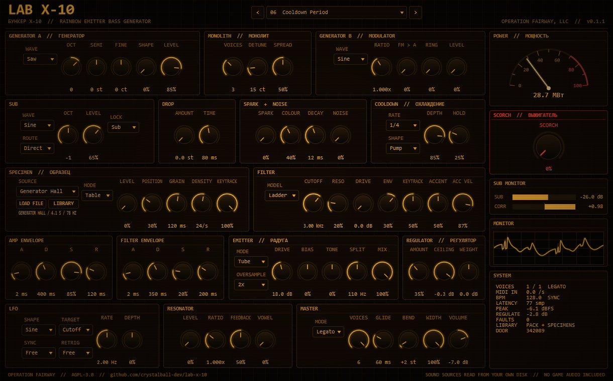

# LAB X-10

A heavy bass synthesizer for Windows, built as a VST® 3 instrument and a standalone app. It is inspired by Lab X-10, the bunker beneath the Radar in *S.T.A.L.K.E.R.: Shadow of Chernobyl*, where generators feed the Rainbow emitter known as the Brain Scorcher. It is made by OPERATION FAIRWAY as a personal tool and the sibling of [LAB X-3](https://github.com/crystalball-dev/lab-x-3).

LAB X-10 is a fan project. It is not affiliated with or endorsed by GSC Game World, and this repository contains no game audio.



## What it does

LAB X-10 makes neutral sub-bass, heavy distorted electronic bass and acid lines. One rule shapes it: **the sub never moves, everything above it burns.** Below the EMITTER's split frequency the signal is mono, phase-locked and undistorted; above it the distortion, modulation and pumping do their damage.

- **GENERATOR A and MONOLITH.** Saw that morphs into a square, pulse, triangle, folded sine, or a wavetable cut from the lab's recordings, through up to seven detuned unison copies spread across the stereo field.
- **GENERATOR B.** A second oscillator that frequency-modulates or ring-modulates A for metallic and inharmonic basses.
- **SUB, LOCK and DROP.** A sine, triangle, square or transformer-style HUM sub, one or two octaves down, routed straight past the filter or through it. LOCK restarts the oscillator phases on every note, so every hit lands identically. DROP starts each note up to three octaves high and falls into place, 808-style.
- **SPARK.** A relay-click or static burst at the start of each note, plus sustained noise.
- **SPECIMEN.** Reads sounds from your own disk: the `stalker sounds` pack that ships with older FL Studio installs, and a STALKER SPECIMENS library of sounds extracted from your own copies of the games. Among them are the Radar's machinery from *Shadow of Chornobyl* and the generator rooms of *S.T.A.L.K.E.R. 2*. In TABLE mode it cuts 16 single-cycle frames from a recording, tuned to the loudest hum, so generators, turbines and transformers become playable wavetables. GRAIN mode is LAB X-3's granular engine.
- **FILTER.** A TB-303 style diode ladder for acid, a transistor ladder for heavy bass, and a clean state-variable filter in low-, band- and high-pass. Velocity accents open the filter and push the level, and repeated accents sweep higher.
- **EMITTER.** Tube, clip, fold, rectify or bit-crush distortion, oversampled up to 4x, applied only above the split. TONE tilts the result, MIX blends it back.
- **LFO and COOLDOWN.** One LFO that locks to the host tempo, with sample-and-hold and a drifting random walk. COOLDOWN is a beat-locked pump or gate on everything above the sub: the emitter's cooling periods.
- **RESONATOR.** A comb filter tuned to the note, through vowel formants, for talking and growling basses.
- **REGULATOR.** Compressor, a 60 Hz WEIGHT shelf and a look-ahead limiter at the output ceiling.
- **SCORCH.** One knob that pushes everything toward the red: drive, detune, resonance, pump depth and resonator feedback. The mod wheel adds to it.
- **16 factory presets**, named after the lore.
- **SYSTEM readout.** Active voices, incoming MIDI, host tempo and sync state, latency, peak level, gain reduction and a fault counter.

## Playing it in FL Studio

- **Slides:** in Legato mode, overlap two notes in the piano roll and the second one slides from the first. Notes that do not overlap retrigger.
- **Accents:** a note is accented when its velocity reaches ACC VEL (87 % by default, about 111 of 127). FL's default velocity of 100 is not accented, so raise the accented notes to full velocity.
- **Note names:** FL Studio calls MIDI note 60 "C5". The bass register this synth is tuned for, MIDI 28 to 48, appears in FL as E2 to C4.
- **Tempo:** the LFO's synced rates and COOLDOWN follow FL's tempo and lock to the bar while the song plays. When it is stopped they keep running at the last tempo FL reported.
- **Latency:** LAB X-10 reports a fixed latency (77 samples at 48 kHz) whatever the oversampling setting, so FL compensates it once and never has to re-align.

## Sound sources

The SPECIMEN layer and the TABLE waveform read audio from folders on your machine. Neither this repository nor its builds include any game audio: `Source/SpecimenCatalog.h` lists 37 relative file paths only.

- **The first 20 sources** come from the `stalker sounds` pack inside an FL Studio installation, found automatically.
- **The other 17** come from a STALKER SPECIMENS library, a folder of sounds you extract from your own installed copies of the games. LAB X-10 finds it automatically at `<drive>:\_AUDIO\STALKER SPECIMENS`, which holds `<game>\sounds\...` folders such as `shadow_of_chornobyl` and `heart_of_chornobyl`.
- **LIBRARY** points the plugin at either kind of folder; it recognises which one you picked.
- **LOAD FILE** uses any WAV, OGG, FLAC or AIFF file.

A missing folder silences only the sources that live in it. Without any, the TABLE waveform falls back to a sine and every other part of the synth still works. Files that decode with a burst of garbage, which happens in some game data, are repaired on load: any sample above +24 dBFS is silenced together with 10 ms either side.

## Building on Windows

You need Visual Studio 2022 Build Tools with the C++ workload, CMake 3.22 or newer, and a checkout of JUCE 9.

```
cmake -S . -B build -G "Visual Studio 17 2022" -A x64 -DLABX10_JUCE_PATH=C:/path/to/JUCE
cmake --build build --config Release --target LabX10_VST3 LabX10_Standalone LabX10Render
```

`scripts/build.ps1` runs both steps.

## Installing in FL Studio

Copy the plugin file into the standard VST3 folder. `scripts/install.ps1` does this and refuses if FL Studio has the plugin loaded:

```
build/LabX10_artefacts/Release/VST3/LAB X-10.vst3/Contents/x86_64-win/LAB X-10.vst3
  -> C:\Program Files\Common Files\VST3\LAB X-10.vst3
```

Then scan for plugins in FL Studio. LAB X-10 appears under Generators.

## Testing

- `LabX10Render` renders presets offline to WAV with a simulated host tempo and reports level, largest sample jump, non-finite samples, latency and render speed.
- `python Tests/run_tests.py` runs the whole battery: pitch at three sample rates, sub purity, phase lock, unison, filter slopes and resonance, accent, slide, drop, emitter harmonics, aliasing, latency, tempo sync, every specimen source, every preset, voice stealing, state round trip, preset switching, a 300-second randomised session, CPU load and pluginval.
- `scripts/validate.ps1` runs [pluginval](https://github.com/Tracktion/pluginval).

## Licence

LAB X-10 is free software under the GNU Affero General Public License v3.0; see `LICENSE`. It is built with [JUCE](https://juce.com) under the AGPLv3 and the Steinberg VST 3 SDK under the MIT licence.

VST is a registered trademark of Steinberg Media Technologies GmbH.
